# Revisão final do Vitor (página de revisão, 11/11) — 13 pontos

Cada recorte mostra o ponto marcado (círculo ciano) no print da prévia pr-48 de 11/11 (960 px de largura = 1440 real).

## 1. privacidade — "remove a sede daqui"

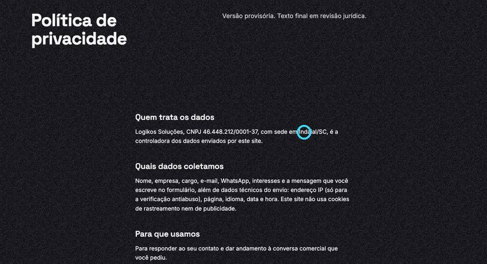 (posição: x 62%, y 22% da página inteira)

## 2. sobre — "centraliza esse texto aqui em relaçao ao por que existimos"

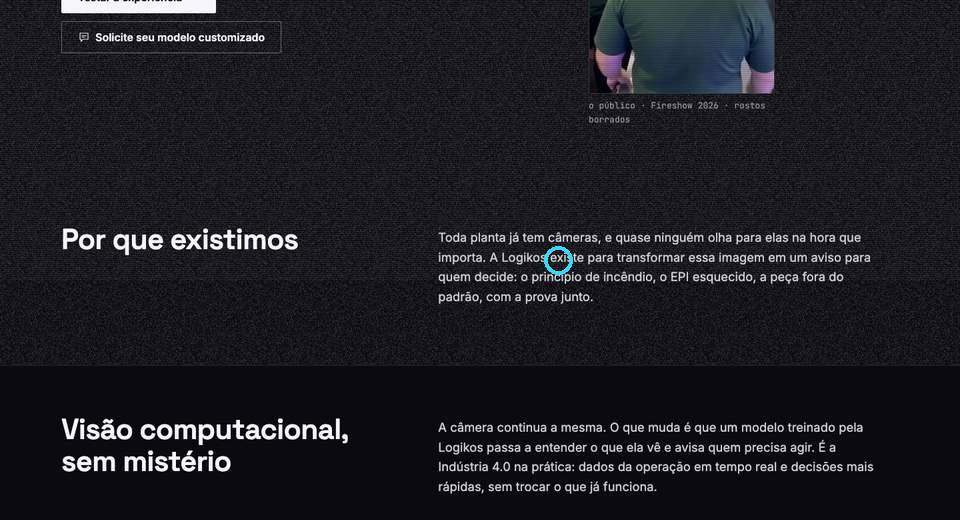 (posição: x 58%, y 25% da página inteira)

## 3. twins — "Falta incluir os gemeos digitais por peça aqui também"

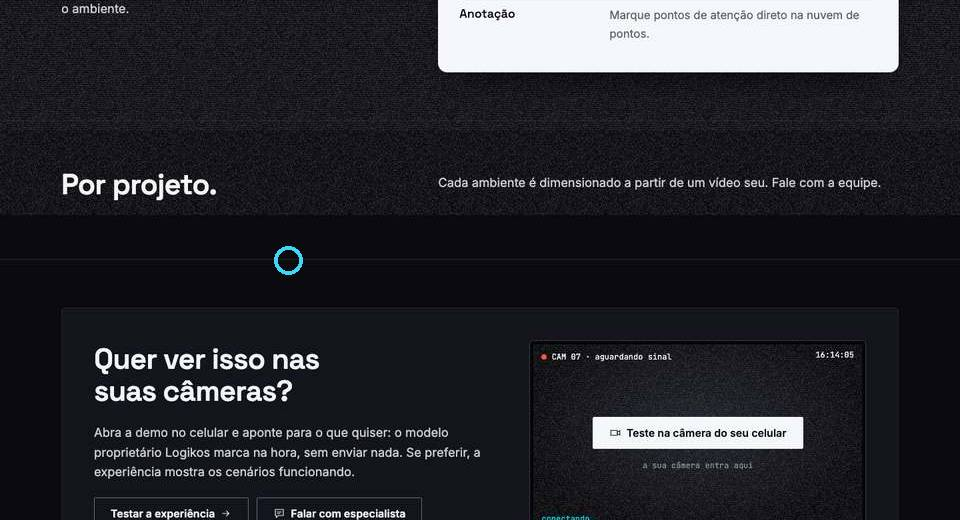 (posição: x 30%, y 58% da página inteira)

## 4. demos — "Aqui nao é sobre reconhecimento de EPi é sobre mostrar como a visao computacional funnciona precisa mudar esse texto"

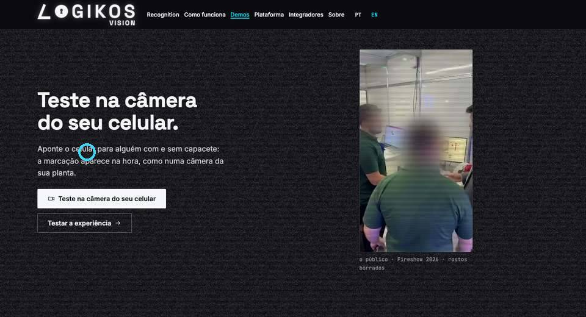 (posição: x 15%, y 17% da página inteira)

## 5. sobre — "Remove o testar experiencia daqui"

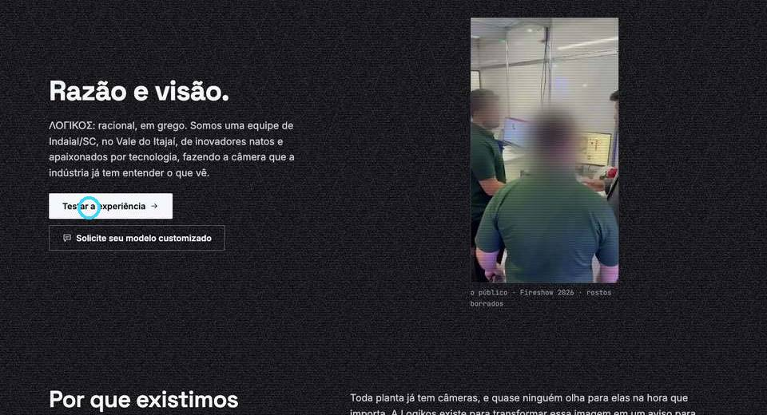 (posição: x 12%, y 14% da página inteira)

## 6. como-funciona — "Remove esse comentario"

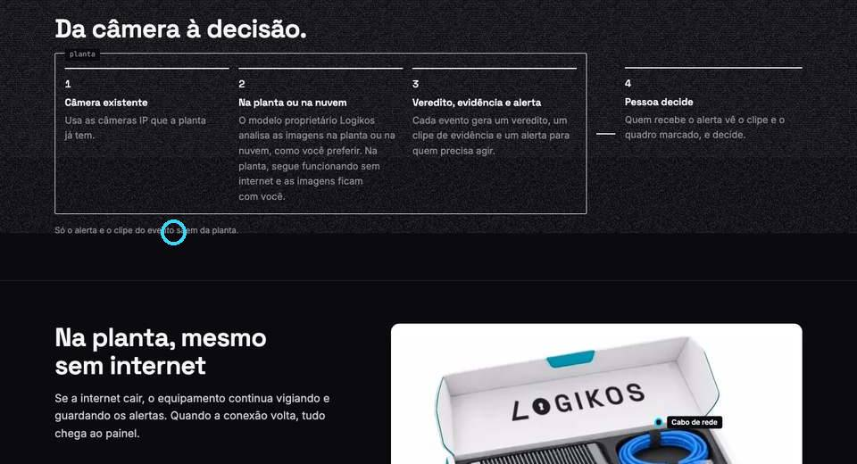 (posição: x 20%, y 29% da página inteira)

## 7. home — "coloca o fundo branco nesse texto aqui pra ele nao ficar ao vento e centraliza"

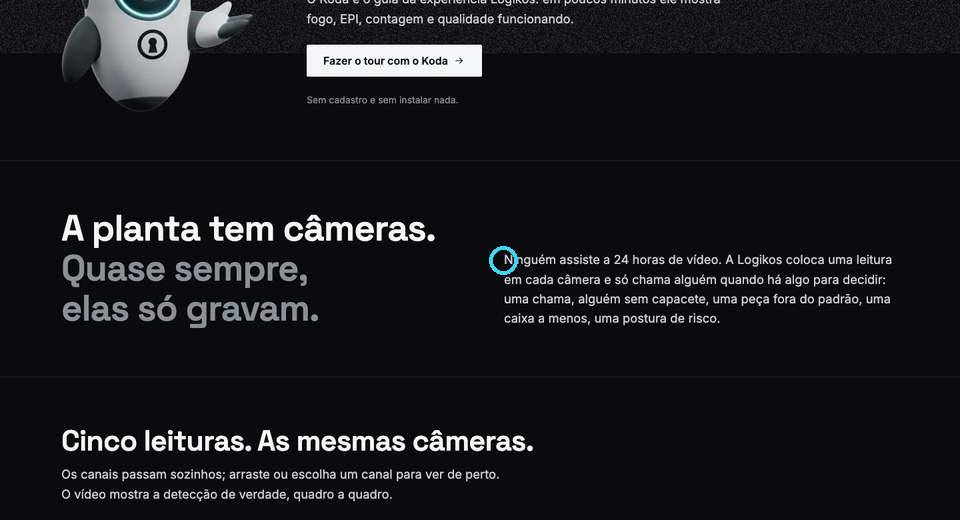 (posição: x 52%, y 22% da página inteira)

## 8. integradores — "Na pagina de integradores nao vamos falar de vender o recognition vamos falar de criar o modelo customizado"

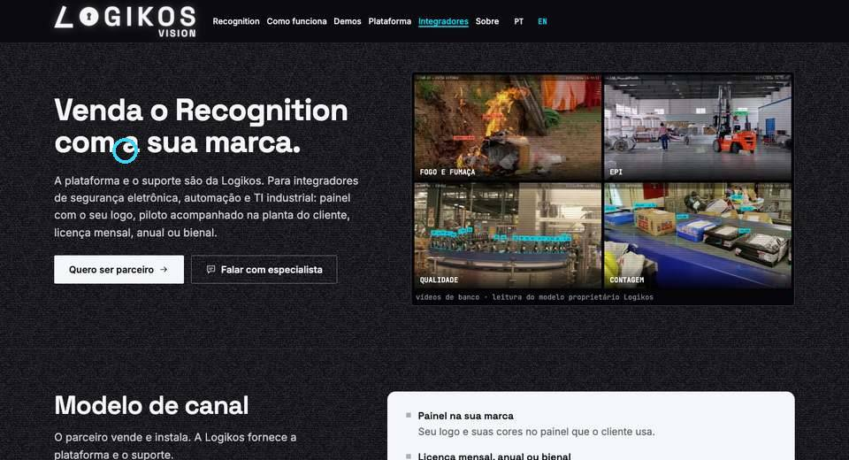 (posição: x 15%, y 10% da página inteira)

## 9. robotica — "Pode remover o testar experiencia aqui"

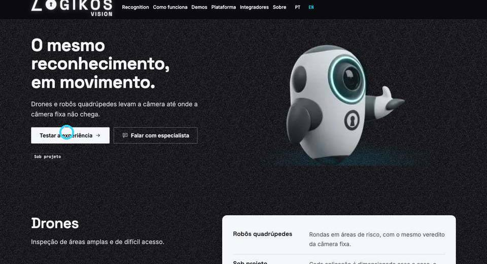 (posição: x 14%, y 21% da página inteira)

## 10. home — "Aqui deve levar para a visao direto da camera sem ir para a lading page de usar o modelo"

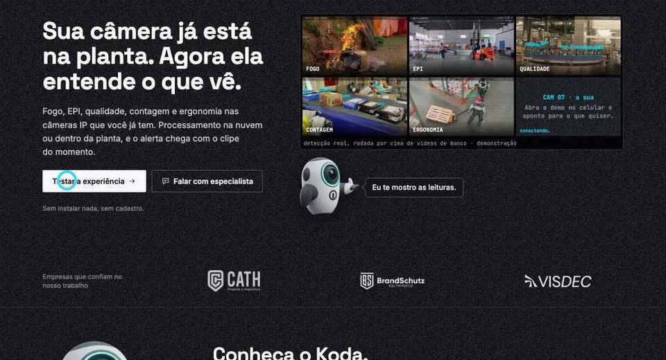 (posição: x 10%, y 8% da página inteira)

## 11. como-funciona — "Coloca um pouco pra cima esse quadro"

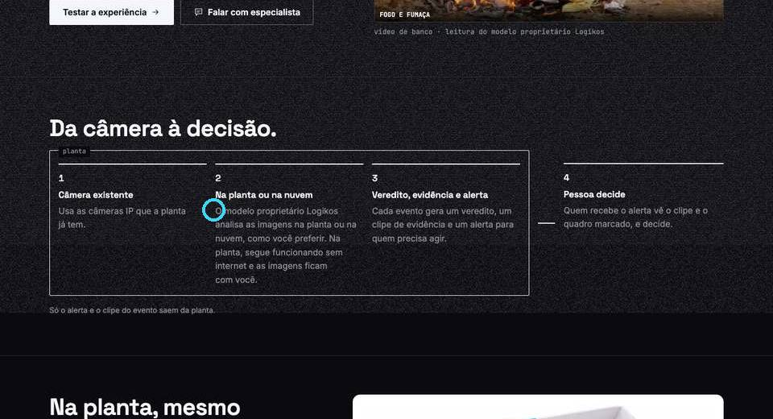 (posição: x 28%, y 24% da página inteira)

## 12. recognition — "coloca aqui as notificaçoes do ap nao essas notifcaçoes em preto"

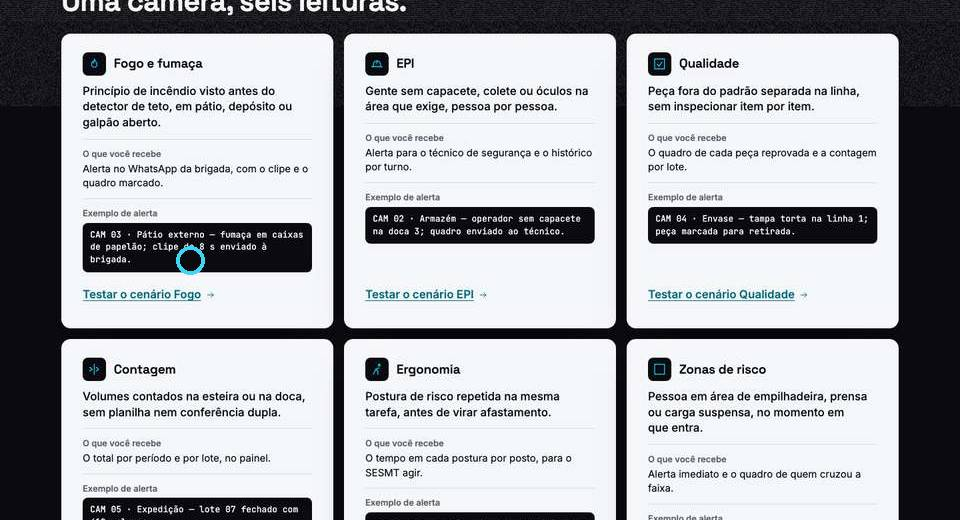 (posição: x 20%, y 25% da página inteira)

## 13. recognition — "Replica isso em todos os cards de colocar a imagem da notificação"

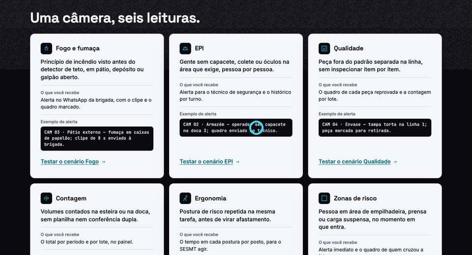 (posição: x 54%, y 24% da página inteira)

## Leitura combinada com o Vitor (como interpretar)

- **1 privacidade:** tirar a sede/endereço (já vale a regra de tirar a cidade em todo o site).
- **2 sobre:** o bloco de texto ao lado de "Por que existimos" centralizado verticalmente em relação ao título.
- **3 twins:** incluir o gêmeo digital por PEÇA (qualidade peça a peça) nessa seção — junto do vídeo do gêmeo quando chegar.
- **4 demos:** o texto da página não é sobre reconhecimento de EPI; é sobre mostrar **como a visão computacional
  funciona** (a câmera passa a entender o que vê, em qualquer cenário). Reescrever o título/introdução.
- **5 sobre e 9 robótica:** remover o botão "Testar a experiência" do herói dessas páginas (fica só o CTA da página).
- **6 como funciona:** remover a frase "Só o alerta e o clipe do evento saem da planta.".
- **7 home:** o parágrafo "Ninguém assiste a 24 horas de vídeo…" vai para um container claro (folha branca) e a
  seção fica centralizada (título e texto), sem texto solto no preto.
- **8 integradores:** a página não fala de revender o Recognition; fala de **criar o modelo customizado** com a
  Logikos (integrador traz o caso, a Logikos treina e entrega o modelo para a operação do cliente). Reescrever.
- **10 home:** o botão "Testar a experiência" do herói tem que levar direto para a experiência, sem passar por
  nenhuma página intermediária; e todos os "Teste na câmera do seu celular" vão abrir **direto na câmera ao vivo**
  (sem a tela inicial da demo) — use `https://logikosvision.com.br/teste-no-seu-celular/?direto=1` (outra frente
  está habilitando esse modo direto na versão Logikos da demo).
- **11 como funciona:** subir o quadro "Da câmera à decisão" (menos espaço acima dele).
- **12 e 13 recognition:** no lugar dos blocos pretos de "Exemplo de alerta" em texto mono, mostrar a
  **notificação do app** como imagem/componente de notificação de celular (cartão branco com ícone Logikos, título,
  texto e hora — o mesmo visual do push da experiência: `~/logikos/cvw-wt/unificada/src/features/experiencia/ui/push-card.tsx`
  como referência visual). Replicar em todos os 6 cartões.

## 14. header — "um espaçamento aqui será necessário"

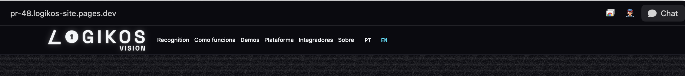
A logo Logikos Vision (maior agora) encosta no menu: dar respiro entre a logo e o primeiro item do menu (≥ 40 px no desktop), alinhar o menu verticalmente ao centro da logo (não à linha do LOGIKOS), e equilibrar o header (logo à esquerda, menu, idioma e CTAs à direita) sem quebrar em 1280 px.
